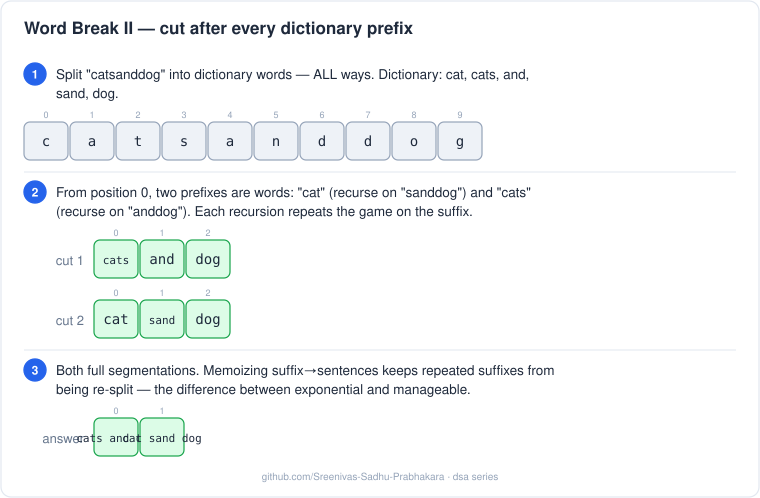

# Word Break (Print All Ways)

> Striver SDE Sheet 060 · Day 10 Backtracking — recurse on "all sentences for this suffix" and memoize per start index; shared suffixes are solved once. Go, stdlib only, tested.

## Problem

Given a string and a dictionary, produce every sentence formed by inserting spaces so that each piece is a dictionary word. `"catsanddog"` yields `cat sand dog` and `cats and dog`.

## Approach

Define the subproblem as "all sentences for the suffix starting at i" — a *set of strings*, not a boolean. Try every dictionary word that prefixes the suffix and combine it with each sentence of the remainder. Memoizing by start index matters because different prefixes funnel into identical suffixes (`cat`+`s…` and `cats`+`…` share everything after position 4). Capping candidate lengths at the longest dictionary word keeps the inner loop honest. The empty-string sentinel for "end reached" is what lets a word that finishes the string join cleanly without a trailing space.

**Complexity:** output-bound exponential worst case; memoization removes recomputation, not the output's size.

## Visual walkthrough

Read the picture top to bottom — each numbered frame is one moment of the algorithm
running on this repo's test example.

## Run

    go test ./...   # verify
    go run .        # demo

---

One of 191 repos solving Striver's SDE Sheet in Go — stdlib only, one problem per repo, every solution tested. Browse the set: [`dsa-*` repos](https://github.com/Sreenivas-Sadhu-Prabhakara?tab=repositories&q=dsa-&type=source).
